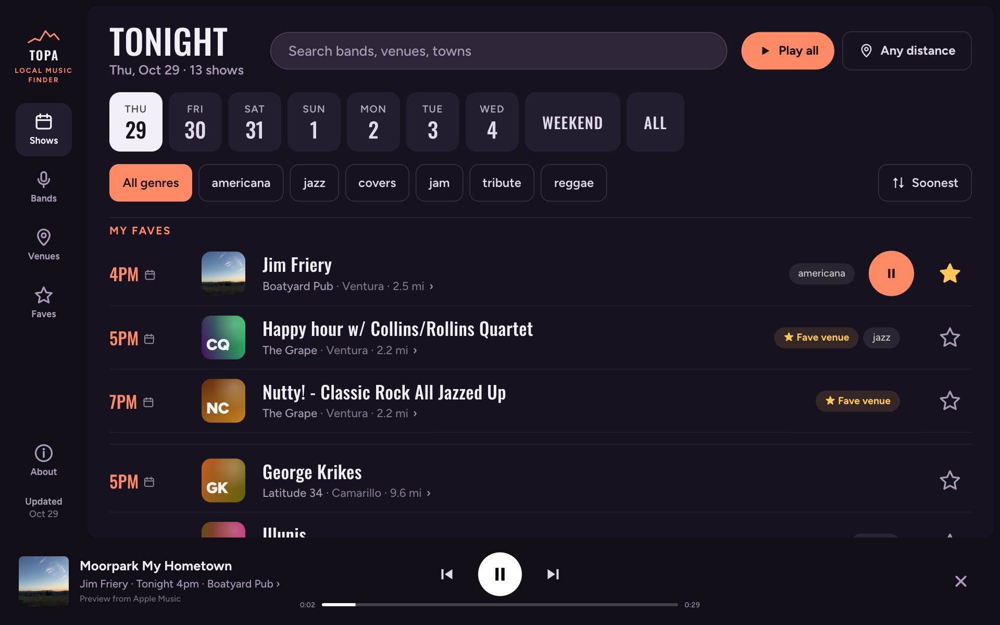
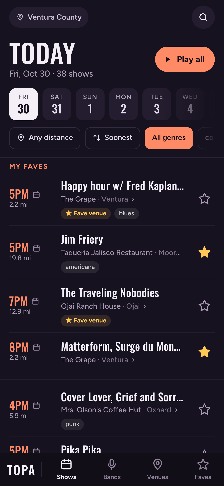
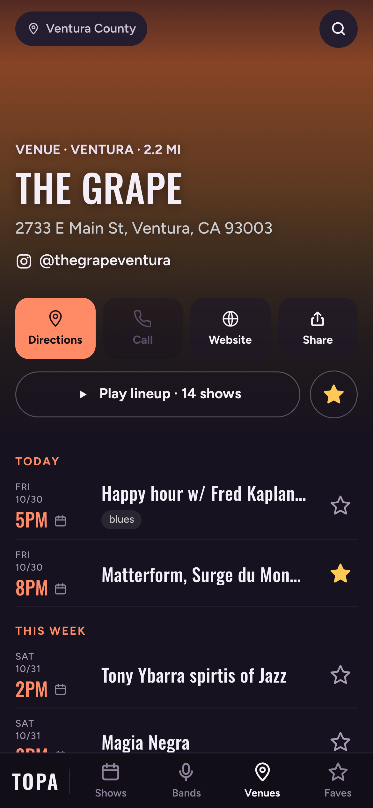
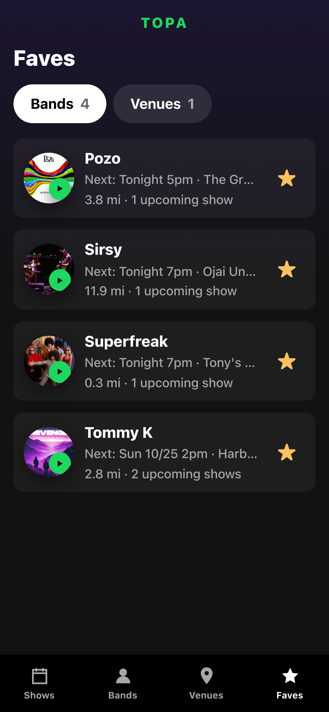
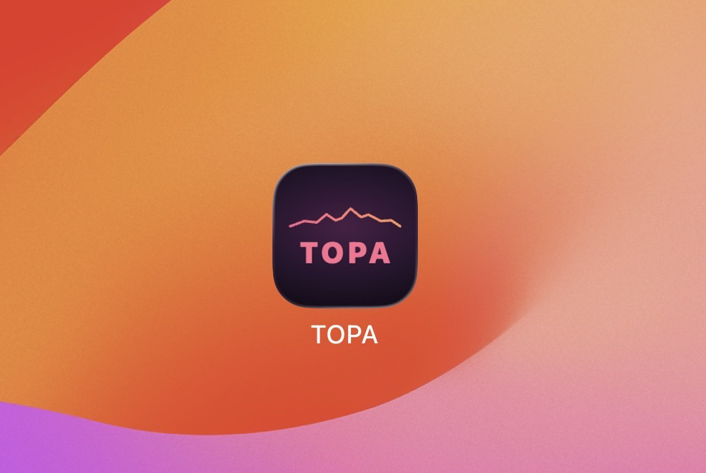

<p align="center"></p>

<h1 align="center">TOPA Local Music Finder</h1>

*A personal project by local music lovers who wanted to find live local music nearby, pick a show fast, and have their Tesla navigate there by voice. The future is now!*

**Who's playing locally tonight, and what do they sound like?** TOPA is a Spotify-style live music finder for Ventura County, designed first for a Tesla's touchscreen and then for phones. Open it, see upcoming shows, tap ▶ to hear a band, and go.



<table>
  <tr>
    <td width="33%"></td>
    <td width="33%"></td>
    <td width="33%"></td>
  </tr>
</table>

More in [`screenshots/`](screenshots/): every page at Tesla size (1920×1200) and phone size.

## Use it

**Open [automatous-io.github.io/topa](https://automatous-io.github.io/topa/)** in any browser. Nothing to sign up for.

**iPhone: add it to your home screen** so it opens full-screen, like an app:

1. Open the link in **Safari**.
2. Tap the **Share** button (the square with an arrow pointing up) at the bottom of the screen.
3. Scroll down and tap **Add to Home Screen**, then **Add**.
4. Open TOPA from the new icon on your home screen. Allow location when it asks if you want distances.



**Android:** open the link in **Chrome**, tap **⋮** (top right), then **Install app** (or **Add to Home screen**). The About page inside the app also has a one-tap **Install TOPA** button when Chrome offers it.

**Tesla:** open the link in the car's browser and bookmark it.

To get new listings, pull down at the top of any page.

## What it does

- **Today first.** It opens on today's shows ("Today" until 4pm, then "Tonight") with big start times, then lets you pick
  another day, the weekend, or a genre. Each row shows the band, venue, town and distance.
- **Hear before you go.** Sunset-colored ▶ buttons play 30-second song previews. "Play all" runs through a whole night's lineup like a radio, and the player shows where and when each band is playing.
- **Bands and venues.** Every band and venue has its own page: dates, lineup, call, website, and directions. The Venues
  tab is a list showing each venue's town, distance, show count and next show.
- **Faves.** Tap any star to fave a band or venue, on a row or right on a band's photo. When a fave is playing on the day
  you're looking at, it's pinned at the top of Shows, and shows at a faved venue are tagged "★ Fave venue". The Faves tab
  switches between your bands and venues.
- **Distance when you want it.** It shows every show by default. Pick 5, 10 or 25 miles to narrow it down. Distances only appear when the browser shares your location, so it never shows guessed ones.
- **Getting there.** For safety, Tesla doesn't let websites start the car's navigation; a map link just opens Google Maps
  in the browser. So in the car, show and venue pages show the phrase to say ("Navigate to The Grape") with the
  address, and the car's voice command does the rest. On phones, directions open the maps app.
- **Works like an app.** Add it to a phone's home screen (see [Use it](#use-it)) and it opens full-screen. It keeps working
  offline with the last listings, pull down to refresh, and the back button (or swipe-back) moves through pages.
- **About.** Credits, how it works, and links to this repo live in an About popup, opened from the sidebar on the Tesla
  or the bottom bar on phones, so the main screens stay clean.

## Design decisions

Built for glancing at a car screen, then refined for phones:

- **Big targets, one tap.** Main buttons are 44–60px tall. Choices are buttons you can see, not dropdowns or sliders. Picking a distance is one tap and closes the panel, and every star faves in one tap without leaving the page.
- **The sidebar sits on the left on the Tesla.** It's the closest edge to the driver, it uses width (which the screen has plenty of) instead of height, and it keeps app buttons away from Tesla's own controls at the bottom. Phones get a bottom tab bar instead.
- **Fewer places to look.** Search sits in the Shows header instead of on its own tab, and there's no separate Home page. The menu is Shows · Bands · Venues · Faves.
- **Short headers.** Title, count, search and the main buttons share one row on the Tesla, so more shows fit on screen.
- **Rows that scroll sideways say so.** Day and genre rows fade at the edge and show ‹ › arrows on the Tesla when more chips
  are hidden. Phones show a cut-off chip and swipe instead.
- **Plain-English times.** "Today 1pm", "Tonight 8pm", or a date like "Sat 10/31" for anything later, and shows that
  already ended drop off.
- **No repeated information.** Single-day lists show only times, since the date is in the title. Band pages lead with the
  venue on each row, and a venue's page drops the venue line, since it's in the header. Each list shows one fave star per band.
- **Its own look: the "Pink Moment."** TOPA is named for the Topa Topa mountains above Ojai, whose bluffs glow pink
  and orange at sunset. That's the palette: a sunset pink-to-orange for play and selected, dusk purples behind it,
  yellow for faves, and the Topa Topa ridgeline over the name.

## How it works

No backend, no API keys, no cost. It's a static site on GitHub Pages plus a scheduled GitHub Action.

```
Ventura Rocks calendar (Tockify)
        │  scripts/fetch_events.py, run by GitHub Actions 3× a day
        ▼
   events.json  ──────────►  index.html + app.js (one page, no build step)
  (facts only)               ├─ loads events.json from the same site
                             ├─ Deezer API (JSONP): artist photos + 30s previews
                             └─ sw.js: offline cache
```

1. **Listings.** [`scripts/fetch_events.py`](scripts/fetch_events.py) (Python standard library only) reads the calendar's public
   `monthly` and `upcoming` pages, keeps only facts (band, time, venue, address, town, tags, link), merges and de-duplicates them,
   and writes `events.json`. If the page won't parse, it exits with an error and leaves the old file alone.
2. **Schedule.** [`.github/workflows/update-events.yml`](.github/workflows/update-events.yml) runs it around 7am, noon and 4pm Pacific
   and commits `events.json` only when the listings changed.
3. **The app.** `index.html` shows the last saved listings right away (so it opens instantly and works offline), then swaps in the
   latest `events.json`. If the scheduled fetch ever fails, the old file stays in place and the "Updated" date stops moving.
4. **Previews.** The app matches each band against Deezer's free API in the background, soonest shows first. A band only gets a
   ▶ when the name matches exactly and there are playable clips. Cover and tribute acts and generic listings ("Open Mic") are skipped,
   because they nearly always match the wrong artist. Matches are remembered on the device for 14 days.

## Run it locally

```sh
python3 scripts/fetch_events.py --upcoming   # refresh events.json
python3 -m http.server 8000                  # then open http://localhost:8000
```

Or double-click `serve.command` on a Mac. Location only works over `https://` or `localhost`.

The version lives at the top of `app.js` (`VERSION`) and shows in the About popup. Bumping it also gives the offline
cache a new name, so every phone and car picks up the new files.

Two address-bar switches help with testing: `?tesla=1` shows the car-only voice hint in any browser, and
`?now=2026-10-24T19:00` pins the date and time.

## Tests

```sh
npm install   # once; the only dependency is for testing (puppeteer-core)
npm test
```

[`tests/app.test.mjs`](tests/app.test.mjs) opens the real app in headless Chrome and uses it like a person would: day and
genre chips, search, starring bands and venues, the Faves tabs, opening a show and going back, the Tesla-only voice hint,
and the phone layout. Each test gets a fresh browser session. Runs are repeatable: listings come from a saved copy
([`tests/fixtures/events.json`](tests/fixtures/events.json)), the clock is pinned, and Deezer and visit counting are
blocked. It uses your installed Chrome, or set `CHROME_PATH`.

[`.github/workflows/test.yml`](.github/workflows/test.yml) runs the same tests on GitHub for every code change, so each
commit gets a ✓ or ✗ before it's tagged as a release.

## Project layout

| Path | What it is |
|---|---|
| `index.html` | The page shell |
| `app.js` | The app: listings, pages, previews, player (sections marked inside) |
| `data.js` | Venue coordinates, phone numbers and websites, plus the genre map |
| `styles.css` | All styles; phone layout in the `max-width: 700px` block at the end |
| `events.json` | Current listings, written by the fetch script |
| `scripts/fetch_events.py` | Pulls and cleans the calendar |
| `.github/workflows/update-events.yml` | Runs the fetch on a schedule |
| `.github/workflows/test.yml` | Runs the tests on every code change |
| `sw.js`, `manifest.json`, `icon-*.png` | Offline support and install icons |
| `screenshots/` | Tesla and phone screenshots |
| `.prettierrc.json` | Code formatting settings ([Prettier](https://prettier.io)) |
| `tests/`, `package.json` | Browser tests (`npm test`) and their saved listings |
| `LICENSE` | All rights reserved; what is and isn't covered |

## Credits

- **Show listings** come from the [Ventura Rocks](https://www.venturarocks.com) public calendar.
- **Visit counts** come from [GoatCounter](https://www.goatcounter.com): anonymous, no cookies, nothing personal.
- **Artist photos and previews** come from [Deezer](https://www.deezer.com) through its public API.

## License

Copyright 2026 [Automatous](https://github.com/automatous-io). All rights reserved. The code is public to read as a portfolio piece, not to reuse; see [LICENSE](LICENSE). All show listings are from the public Ventura Rocks calendar; artist photos and previews are from Deezer.
