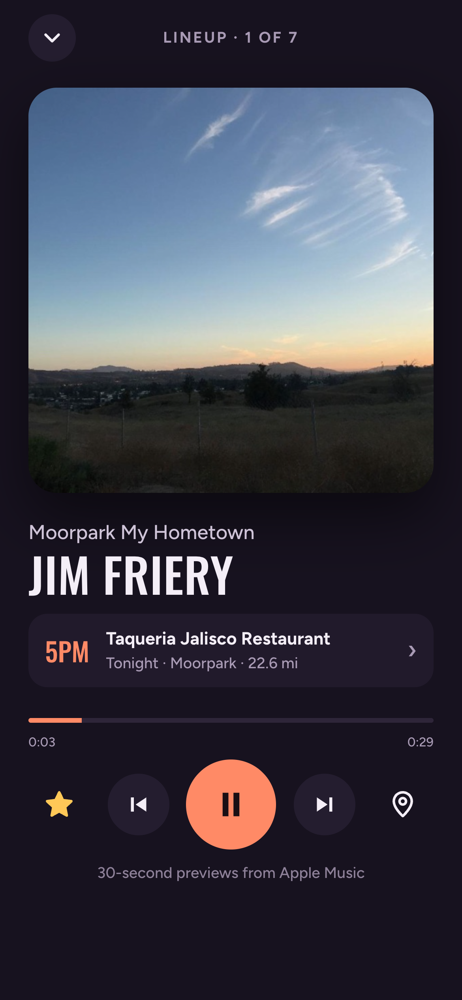
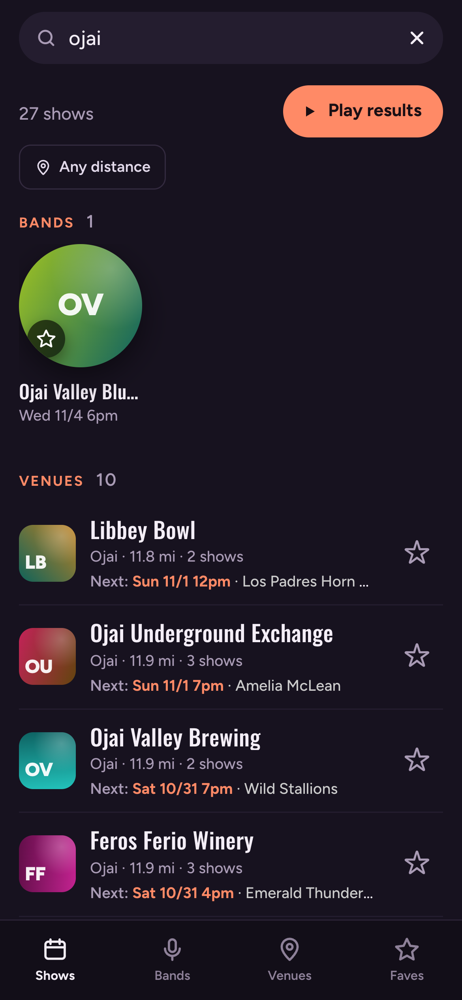

<p align="center"></p>

<h1 align="center">TOPA Local Music Finder</h1>

*Made for and by local live music lovers. Bands, fans, and venues add to it, so it keeps getting better.*

**Who's playing locally tonight, and what do they sound like?** TOPA is a live music finder for Ventura County that I built for my Tesla's touchscreen, and then for phones. Open it, see upcoming shows, tap ▶ to hear a band, and go.


<table>
  <tr>
    <td width="25%"></td>
    <td width="25%"></td>
    <td width="25%"></td>
    <td width="25%"></td>
  </tr>
</table>

More in [`screenshots/`](screenshots/): every page on the Tesla screen (1920×1200, as the car draws it) and on a phone.

## What it does

- **Today first.** It opens on today's shows ("Today" until 4pm, then "Tonight") with big start times, then lets you pick
  another day, the weekend, or a genre. Each row shows the band, venue, town and distance.
- **Hear before you go.** ▶ plays 30-second previews from Apple Music. "Play all" runs through a whole night's lineup
  like a radio. Tap the player to open it full screen.
- **Bands and venues.** Every band and venue has its own page: dates, lineup, directions, call and website, plus the
  band's links and photo when it has sent them. The Venues tab lists each venue's town, distance, show count and next show.
- **Anyone can add a show.** Bands, fans, and venues send shows, band info, and venue photos through short forms
  (tap the TOPA logo → Add your show). Each one is checked before it goes live. Shows sent this way get a small **@**;
  shows from the Ventura Rocks community calendar get a small calendar.
- **Faves.** Tap any star to fave a band or venue, on a row or right on a band's photo. When a fave is playing on the day
  you're looking at, it's pinned at the top of Shows, and shows at a faved venue are tagged "★ Fave venue". The Faves tab
  switches between your bands and venues.
- **Distance when you want it.** It shows every show by default. Pick 5, 10 or 25 miles to narrow it down. Distances only appear when the browser shares your location, so it never shows guessed ones.
- **Getting there.** For safety, Tesla doesn't let websites start the car's navigation; a map link just opens Google Maps
  in the browser. So in the car, show and venue pages show the phrase to say ("Navigate to The Grape") with the
  address, and the car's voice command does the rest. On phones, directions open the maps app.
- **Ask your car.** An AI assistant like Grok, built into Teslas, can answer questions like "what's playing this weekend?" or "is jazz playing this Friday in Ventura?" from
  [`llms.txt`](https://topa.automatous.io/llms.txt), a plain-English copy of the listings, with no app needed.
- **Works like an app.** Add it to a phone's home screen (see [Try it](#try-it)) and it opens full-screen. It keeps working
  offline with the last listings, pull down to refresh, and the back button (or swipe-back) moves through pages.
- **About.** Credits and links live behind the TOPA logo, so the main screens stay clean.

## Try it

**Open [topa.automatous.io](https://topa.automatous.io/)** in any browser. Nothing to sign up for.

**iPhone: add it to your home screen** so it opens full-screen, like an app:

1. Open the link in **Safari**.
2. Tap the **Share** button (the square with an arrow pointing up) at the bottom of the screen.
3. Scroll down and tap **Add to Home Screen**, then **Add**.
4. Open TOPA from the new icon on your home screen. Allow location when it asks if you want distances.

**Android:** open the link in **Chrome**, tap **⋮** (top right), then **Install app** (or **Add to Home screen**). The About page inside the app also has a one-tap **Install TOPA** button when Chrome offers it.

**Tesla:** open the link in the car's browser and bookmark it. **Best viewed full screen:** tap the expand arrows at the
left of the browser's address bar. It also works with the car's side panel open, just with less room. If show pages don't
show the **Say "Navigate to…"** card, open [topa.automatous.io/?tesla=1](https://topa.automatous.io/?tesla=1)
once; the car remembers it.

To get new listings, pull down at the top of any page.

**Ask an AI assistant instead:** [`llms.txt`](https://topa.automatous.io/llms.txt) lists every upcoming show in plain English,
so an assistant like Grok (built into Teslas) can answer "what's playing this weekend?" without the app. Point it at
`https://topa.automatous.io/llms.txt`.

## Design decisions

Built for glancing at a car screen, then refined for phones:

- **Big targets, one tap.** Main buttons are 44–60px tall. Choices are buttons you can see, not dropdowns or sliders. Picking a distance is one tap and closes the panel, and every star faves in one tap without leaving the page.
- **The sidebar sits on the left on the Tesla.** It's the closest edge to the driver, it uses width (which the screen has plenty of) instead of height, and it keeps app buttons away from Tesla's own controls at the bottom. Phones get a bottom tab bar instead.
- **Fewer places to look.** No search tab and no Home page: search lives in the Shows header on the Tesla and in the
  top bar on phones. The menu is Shows · Bands · Venues · Faves.
- **The layout moves with the screen.** Sizes adjust as the screen gets wider or narrower, so TOPA fits the Tesla at
  full screen, the narrower view when the car's side panel is open, a laptop window, and a phone, without anything
  oversized or cramped. (The car's browser is zoomed in, so full screen behaves like a 1280px-wide window.)
- **Short headers.** Title, count, search and the main buttons share one row on the Tesla, so more shows fit on screen.
  Day titles are just the weekday, so Play all never moves.
- **Rows that scroll sideways say so.** Day and genre rows fade at the edge and show ‹ › arrows on the Tesla when more chips
  are hidden. Phones show a cut-off chip and swipe instead.
- **Plain-English times.** "Today 1pm", "Tonight 8pm", or a date like "Sat 10/31" for anything later, and shows that
  already ended drop off.
- **No repeated information.** Single-day lists show only times, since the date is in the title. Band pages lead with the
  venue on each row, and a venue's page drops the venue line, since it's in the header. Each list shows one fave star per band.
- **Its own look.** Named for the Topa Topa mountains above Ojai: dusk purple, sunset coral, and the ridgeline over the
  name. Names and times are in Oswald, like a gig poster; the rest is Figtree. Both fonts ship with the app.

## How it works

No backend, no API keys, no cost. It's a static site on GitHub Pages plus GitHub Actions.

```
Ventura Rocks calendar (Tockify)        Bands, fans, venues
        │                                 │  GitHub form → bot checks it → pull request → approved
        │                                 ▼
        │                            community/ (one small file per show, band or venue)
        │                                 │
        └──── scripts/fetch_events.py, 3× a day and on every approval ────┘
                          ▼
   events.json  ──────────►  index.html + app.js (one page, no build step)
  (facts only)               ├─ loads events.json from the same site
        │                    ├─ Apple Music (iTunes Search API): 30s previews + album art
        │                    └─ sw.js: offline cache
   llms.txt  ─────────────►  AI assistants (Grok in the car, others)
  (plain English)
```

1. **Listings.** [`scripts/fetch_events.py`](scripts/fetch_events.py) (Python standard library only) reads the Ventura Rocks
   calendar's public `monthly` and `upcoming` pages and the shows people sent to TOPA (`community/`), keeps only facts (band,
   time, venue, address, town, tags, link), and merges them. When both list the same show (same venue, day and band), the one
   sent to TOPA wins. It writes every time in Pacific with a plain-English `when` ("Sat Oct 24, 7:00 PM"), then writes
   `events.json` and `llms.txt`: every upcoming show by day in plain English, with addresses and links. If the calendar won't
   parse, it exits with an error and leaves the old file alone.
2. **Sending a show.** Each form in [`.github/ISSUE_TEMPLATE`](.github/ISSUE_TEMPLATE) opens a GitHub issue.
   [`submission.yml`](.github/workflows/submission.yml) checks it with
   [`scripts/submissions.py`](scripts/submissions.py) and either comments with what to fix or opens a pull request adding
   one file under `community/`. Updates to a band or venue change only what's filled in, and the pull request lists just
   those changes. Photos are shrunk and stripped of location data ([`scripts/photos.py`](scripts/photos.py)). Merging
   publishes it.
3. **Schedule.** [`.github/workflows/update-events.yml`](.github/workflows/update-events.yml) runs the fetch around 7am, noon
   and 4pm Pacific, and right after a submission is merged. It commits `events.json` and `llms.txt` only when they changed,
   and keeps the forms' venue lists current ([`scripts/forms.py`](scripts/forms.py)).
4. **The app.** `index.html` shows the last saved listings right away (so it opens instantly and works offline), then swaps in the
   latest `events.json`. If the scheduled fetch ever fails, the old file stays in place and the "Updated" date stops moving.
5. **Previews.** The app looks up each band on Apple Music's free search API in the background, soonest shows and what's on
   screen first (Apple allows about 20 lookups a minute). A band only gets a ▶ when the name matches exactly and there are
   playable clips. Cover and tribute acts and generic listings ("Open Mic") are skipped. A band can set the right Apple Music
   artist, or turn previews off, through its band form. Matches are remembered on the device for 14 days.

## Run it locally

```sh
python3 scripts/fetch_events.py --upcoming   # refresh events.json
python3 -m http.server 8000                  # then open http://localhost:8000
```

Or double-click `serve.command` on a Mac. Location only works over `https://` or `localhost`.

The version lives at the top of `app.js` (`VERSION`) and shows in the About popup. Bumping it also gives the offline
cache a new name, so every phone and car picks up the new files.

Two address-bar switches help with testing: `?tesla=1` turns on the car-only voice hint and remembers it on that device (`?tesla=0` turns it off), and
`?now=2026-10-24T19:00` pins the date and time.

## Tests

```sh
npm install                          # once; the only dependency is for testing (puppeteer-core)
npm test                             # the app, in headless Chrome
python3 -m unittest discover tests   # forms, merging sources
```

[`tests/app.test.mjs`](tests/app.test.mjs) opens the real app in headless Chrome and uses it like a person would: day and
genre chips, search, starring bands and venues, the Faves tabs, opening a show and going back, the Tesla-only voice hint,
and the phone layout. Each test gets a fresh browser session. Runs are repeatable: listings come from a saved copy
([`tests/fixtures/events.json`](tests/fixtures/events.json)), the clock is pinned, and Apple Music and visit counting are
blocked. It uses your installed Chrome, or set `CHROME_PATH`.

[`.github/workflows/test.yml`](.github/workflows/test.yml) runs the same tests on GitHub for every code change, so each
commit gets a ✓ or ✗ before it's tagged as a release.

## Project layout

| Path | What it is |
|---|---|
| `index.html` | The page shell |
| `app.js` | The app: listings, pages, previews, player (sections marked inside) |
| `data.js` | Venue coordinates, phone numbers and websites, plus the genre map |
| `styles.css` | All styles; phone rules in the `max-width: 700px` blocks |
| `fonts/` | Oswald and Figtree, with their licenses |
| `events.json` | Current listings, written by the fetch script |
| `llms.txt` | The same listings in plain English for AI assistants, also written by the fetch script |
| `scripts/fetch_events.py` | Pulls the calendar, merges in the shows sent to TOPA, writes `events.json` and `llms.txt` |
| `scripts/community.py` | Reads and checks the shows, bands and venues people send |
| `scripts/submissions.py` | Turns a filled-in form into a file for a pull request |
| `scripts/forms.py` | Keeps the forms' venue lists current |
| `scripts/photos.py` | Shrinks band and venue photos |
| `community/` | Shows, bands and venues people sent, one file each |
| `.github/ISSUE_TEMPLATE/` | The four forms: a show, a weekly show, a band, a venue |
| `.github/workflows/submission.yml` | Checks each form and opens the pull request |
| `.github/workflows/update-events.yml` | Runs the fetch on a schedule and after each approval |
| `.github/workflows/test.yml` | Runs the tests on every code change |
| `sw.js`, `manifest.json`, `icon-*.png` | Offline support and install icons |
| `screenshots/` | Tesla and phone screenshots |
| `.prettierrc.json` | Code formatting settings ([Prettier](https://prettier.io)) |
| `tests/`, `package.json` | Browser tests (`npm test`), Python tests, and saved listings |
| `CHANGELOG.md` | Changes by version |
| `LICENSE` | All rights reserved; what is and isn't covered |

## Credits

- **Show listings** come from the [Ventura Rocks](https://www.venturarocks.com) community calendar and from the bands, fans,
  and venues who send them to TOPA.
- **Visit counts** come from [GoatCounter](https://www.goatcounter.com): anonymous, no cookies, nothing personal.
- **Previews and album art** come from [Apple Music](https://music.apple.com) through its public search API. Band and venue
  photos are sent by the bands and venues themselves.

## License

Copyright 2026 [Automatous](https://github.com/automatous-io). All rights reserved. The code is public to read as a portfolio piece, not to reuse; see [LICENSE](LICENSE). Show listings are from the Ventura Rocks community calendar and from bands, fans, and venues; previews and album art are from Apple Music.
